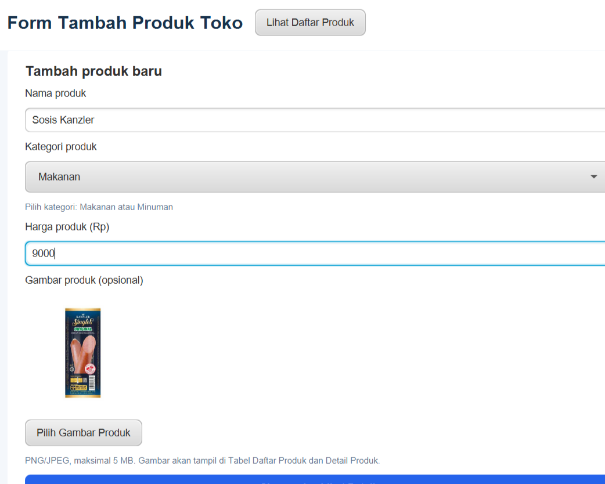
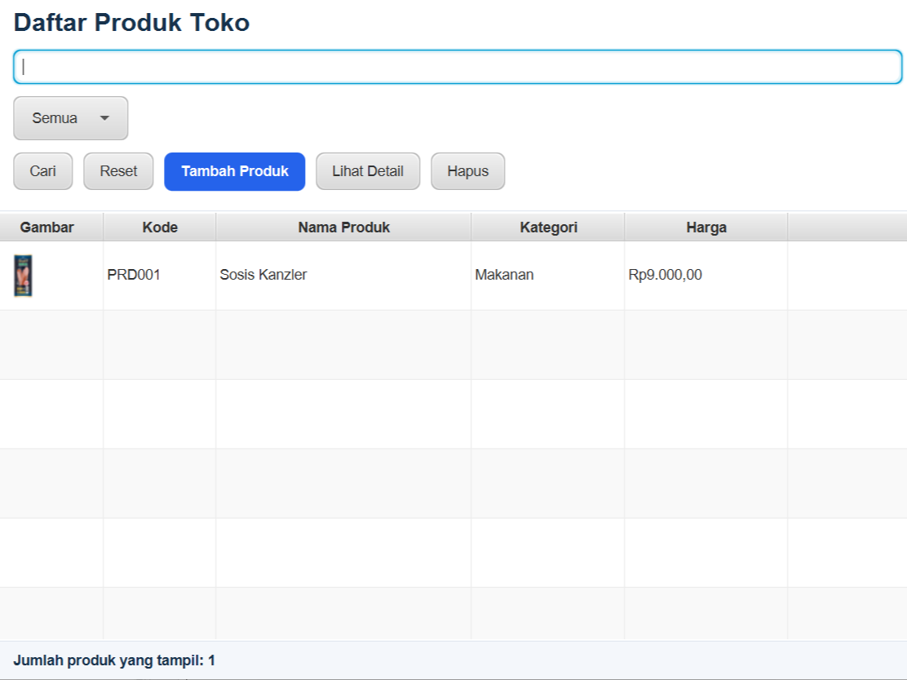
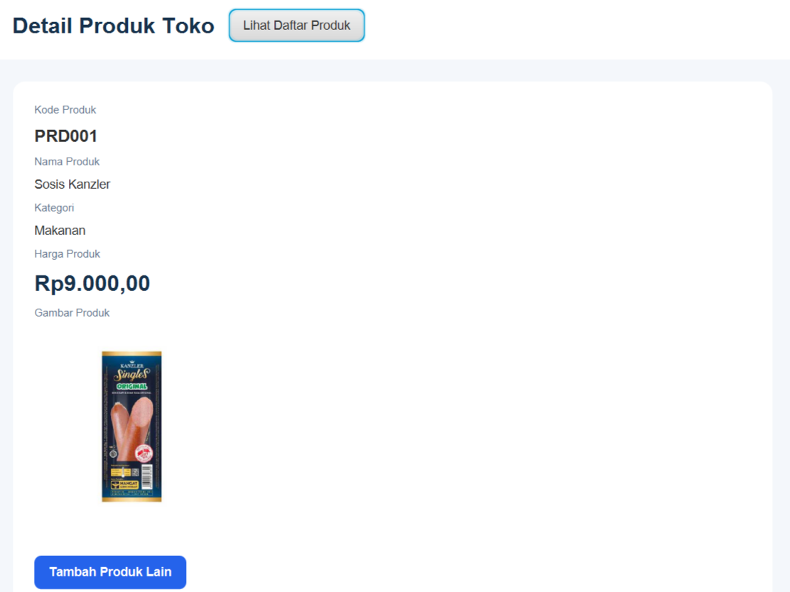

# Aplikasi Manajemen Produk

Aplikasi Manajemen Produk merupakan aplikasi berbasis Java yang dibuat menggunakan JavaFX sebagai antarmuka pengguna (GUI). Aplikasi ini digunakan untuk mengelola data produk, mulai dari menambahkan produk hingga menampilkan daftar produk beserta foto barang.

## Fitur Aplikasi

* Menambahkan data produk.
* Mengunggah foto produk dari komputer.
* Menampilkan foto produk pada daftar produk.
* Menampilkan informasi produk.
* Mengelola data produk melalui antarmuka JavaFX.

## Cara Menjalankan Aplikasi

### 1. Clone Repository

Buka terminal atau Command Prompt, kemudian jalankan perintah berikut:

```bash
git clone https://github.com/dafiputrag07-stack/Daftar-Produk-Toko.git
```

### 2. Masuk ke Folder Project

```bash
cd ProdukToko
```

### 3. Jalankan Aplikasi

Pastikan Java JDK dan Maven sudah terpasang di komputer.

Jalankan perintah berikut:

```bash
mvn clean javafx:run
```

Tunggu hingga proses build selesai. Aplikasi Manajemen Produk akan terbuka.

### 4. Menjalankan Melalui NetBeans IDE

1. Buka NetBeans IDE.
2. Pilih *File → Open Project*.
3. Pilih folder project hasil clone.
4. Tunggu hingga konfigurasi Maven selesai.
5. Klik kanan pada project, kemudian pilih *Run*.

## Cara Penggunaan

1. Buka aplikasi Manajemen Produk.
2. Pilih menu untuk menambahkan produk.
3. Masukkan informasi produk yang diperlukan.
4. Pilih foto produk dari komputer melalui fitur unggah foto.
5. Simpan data produk.
6. Produk yang berhasil ditambahkan akan ditampilkan pada daftar produk beserta fotonya.

## Tampilan Aplikasi

Berikut merupakan tampilan antarmuka aplikasi Manajemen Produk:




